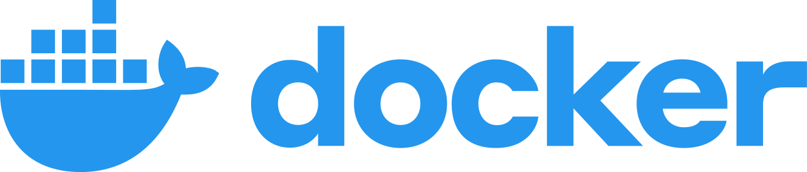

# WG Technology Labs


<!-- Created with GitHub Repo Banner by Waren Gonzaga: https://ghrb.waren.build -->

**WG Technology Labs** publishes open-source libraries, community support bots, and release automation.

[Live website](https://wgtechlabs.com/) · [GitHub organization](https://github.com/wgtechlabs)

## 💎 Sponsors & Partners

<table>
  <tr>
    <td width="50%" align="center">
      <a href="https://railway.com"><picture><source media="(prefers-color-scheme: dark)" srcset="./.github/assets/sponsors/railway-logotype-light.svg"></picture></a>
      <p>Cloud platform for deploying and hosting apps, databases, and infrastructure.</p>
    </td>
    <td width="50%" align="center">
      <a href="https://www.docker.com"></a>
      <p>Platform for building, sharing, and running containerized applications.</p>
    </td>
  </tr>
</table>

## ✨ Features

- Browse selected public projects grouped by topic.
- Open project repositories directly from the catalog.
- Find organization updates through the linked social channels.

## 🚀 Getting Started

Install [Bun](https://bun.sh/) and Git, then start the local development server:

```sh
git clone https://github.com/wgtechlabs/wgtechlabs.github.io.git
cd wgtechlabs.github.io
bun install
bun run dev
```

Open the local address printed by Vite.

## 📖 Usage

Visit the [live website](https://wgtechlabs.com/) and browse the project groups. Select a project to open its public repository, or use the GitHub link to view the full organization.

## 🚢 Deployment

The `main` branch deploys to GitHub Pages. The deployment workflow installs dependencies with Bun, builds the site, and publishes the generated `dist/` directory.

## 🛠️ Development

Page content lives in `index.html`; styles live in `src/style.css`.

Build and preview the production site with:

```sh
bun run build
bun run preview
```

## 🤝 Contributing

Read [AGENTS.md](AGENTS.md) before making changes. This repository follows [Clean Workflow](https://github.com/wgtechlabs/clean-workflow): create a short-lived branch from `dev`, target pull requests at `dev`, and use the [Clean Commit](https://github.com/wgtechlabs/clean-commit) format.

Run `bun run build` before submitting a website change.

## 🐛 Issues & Support

Report a website issue through the [GitHub issue tracker](https://github.com/wgtechlabs/wgtechlabs.github.io/issues).

## 📄 License

No license is specified in this repository.

## 👥 Authors & Contributors

Maintained by [WG Technology Labs](https://github.com/wgtechlabs). See the [contributors graph](https://github.com/wgtechlabs/wgtechlabs.github.io/graphs/contributors).
